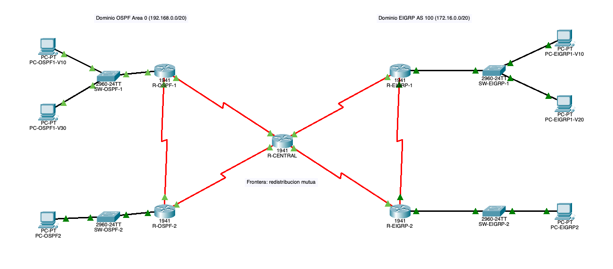

# Laboratorio 3: Algoritmos de Enrutamiento

Redes, Sección 10. Universidad del Valle de Guatemala.

Red en Packet Tracer con una sede en OSPF y otra en EIGRP, unidas por R-CENTRAL con redistribución mutua.



## Cómo abrirlo

```bash
git clone https://github.com/GenserDev/Lab-Redes-Algoritmos-Enrutamiento.git && cd Lab-Redes-Algoritmos-Enrutamiento
```

```bash
open Lab3-Enrutamiento.pkt
```

## Entregables

En la carpeta `entregables` está:

**Parte-Manual-Redes.pdf.** Cálculos VLSM, tabla de direccionamiento y conceptos, hechos a mano.

**Evidencias.pdf.** Tablas de enrutamiento, balanceo OSPF y EIGRP, y prueba de ping y tracert.

**evidencias/.** Los logs de los comandos show y las capturas de la topología y del ping y tracert.
